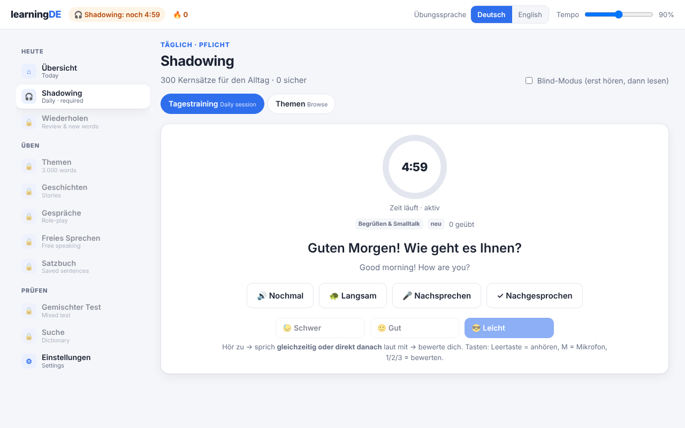
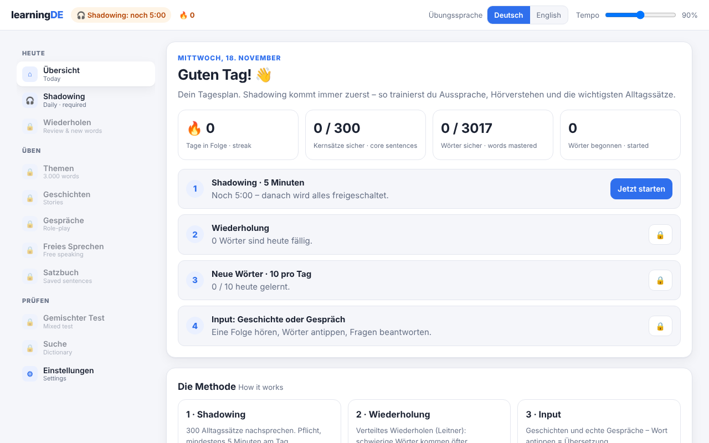
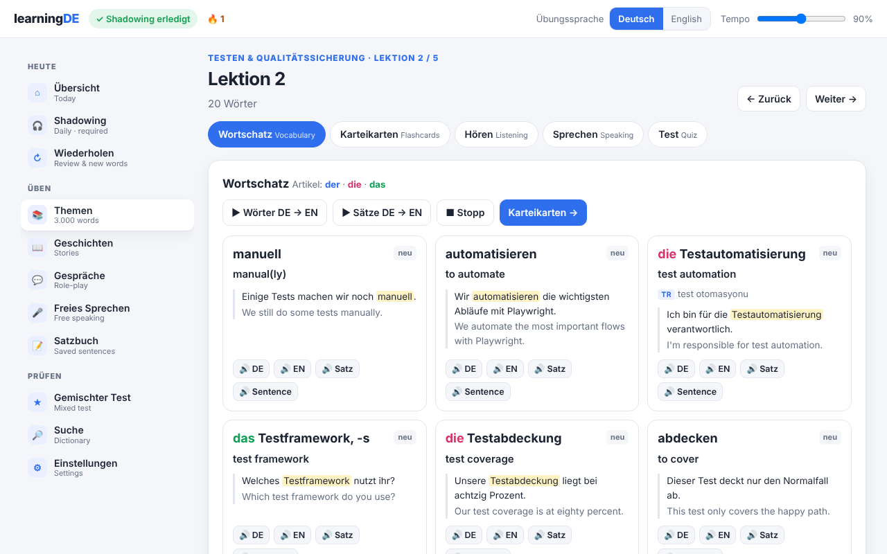
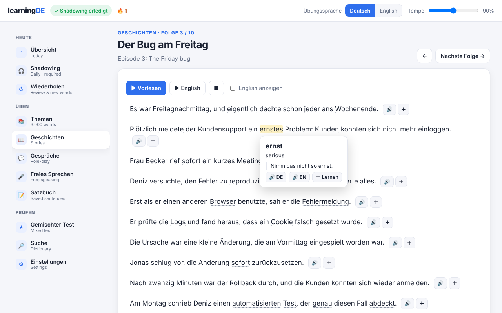
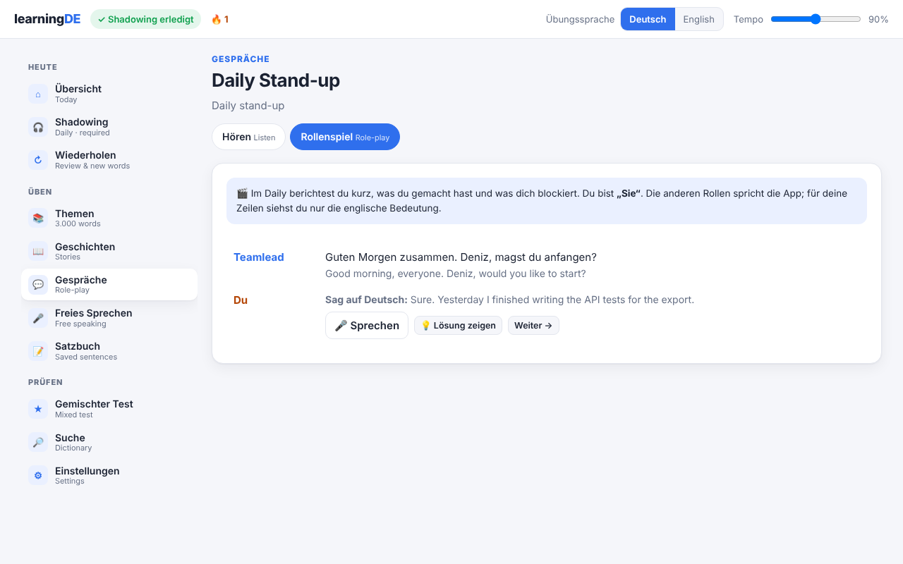

# learningDE 🇩🇪

**Learn German to B2 – for everyday life in Germany and for working in IT.**
3,000 words, daily mandatory shadowing, stories, real conversations with role-play, dictation and spaced repetition.
Runs completely offline in your browser – no account, no tracking, no build step.

[](https://github.com/bluewave07/learningDE/actions/workflows/ci.yml)
[](LICENSE)



---

## Why this app?

Most apps teach isolated words. learningDE is built around four methods that research and experienced teachers agree on:

| Method | What it means here |
| --- | --- |
| **Shadowing** | Listen to a native-speed sentence and repeat it out loud at the same time or right after. Trains pronunciation, rhythm and listening at once. **At least 5 minutes of real practice every day are mandatory** – the rest of the app stays locked until you've done them. |
| **Spaced repetition** | Every word and every core sentence lives in a Leitner box. Hard items come back tomorrow, easy ones in a week, then a month. |
| **Comprehensible input** | A 10-episode story series and themed texts just above your level. Tap any underlined word to see its meaning. |
| **Output** | Role-play real conversations (you speak your part, the app plays the others), dictation, free speaking against a 90-second timer. |

## Features

- 🎧 **Daily shadowing gate** – 300 core everyday sentences in 15 situations (doctor, landlord, Bürgeramt, phone, meetings, IT team …). Once you start a session the clock runs continuously; it pauses automatically after 30 seconds without any tap or when the app is in the background, so leaving it open does not fill the goal.
- 🗣️ **24 paragraph shadowing texts** – one connected first-person text per theme (my job, at the doctor's, our sprint, an evening release …). Shadow it sentence by sentence, then the whole paragraph in one go.
- 📚 **3,017 words in 32 themes** – about 2,000 general B2 words and 1,000 IT words, each with article colour, plural, an example sentence and its English translation.
- 🇬🇧 **German ↔ English throughout** – every word and sentence can be heard in both languages. Switch the *practice language* to English to train dictation, speaking and flashcards in English too.
- 🇹🇷 **Turkish only where it helps** – 435 complex words (bureaucracy, idioms, long compounds) also have a Turkish gloss.
- 📖 **Story series “Deniz in Deutschland”** – 10 episodes following a QA engineer's first year in Munich, with comprehension questions.
- 💬 **12 real conversations with role-play** – calling the GP, broken heating, job interview, daily stand-up, complaining in a restaurant …
- 🎤 **Speech recognition** – your spoken sentence is compared word by word with the original and scored.
- ✍️ **Dictation** for every text, plus listening quizzes and five question types in every test.
- 📝 **Sentence notebook** – save sentences from stories and dialogues and shadow them later.
- 🔎 **Dictionary search** across German, English and Turkish.
- 🔥 **Streak, daily plan and progress export/import** – progress is stored only in your browser.
- 📲 **Installable app (PWA)** – home-screen icon, full-screen, works offline on Android, iOS and desktop.

| | |
| --- | --- |
|  |  |
|  |  |

## Quick start

**Use it online / install it as an app**

Open **<https://bluewave07.github.io/learningDE/>** and install it:

| Device | How to install |
| --- | --- |
| Android (Chrome) | Tap **📲 App installieren** in the header, or menu ⋮ → *Install app* |
| iPhone / iPad (Safari) | Share button → *Add to Home Screen* |
| Desktop (Chrome / Edge) | **📲 App installieren** in the header, or the install icon in the address bar |

Once installed it starts full-screen from your home screen and works **completely offline** (the speech recognition still needs internet).

**Option 1 – just open it**

Download or clone the repo and double-click `index.html`. Everything works offline.

**Option 2 – local server (recommended for the microphone)**

Some browsers block the microphone for files opened from disk. Start a tiny local server instead:

```bash
git clone https://github.com/bluewave07/learningDE.git
cd learningDE
npm start            # or: python3 -m http.server 8000
```

Then open <http://localhost:8000>.

### Browser support

| Feature | Chrome / Edge | Safari | Firefox |
| --- | --- | --- | --- |
| Text-to-speech (DE + EN) | ✅ | ✅ | ✅ (needs system voices) |
| Speech recognition | ✅ (needs internet) | ⚠️ partial | ❌ – use “Nachgesprochen ✓” |

If no German voice is found, install one in your OS (Windows: *Settings → Time & language → Speech*, macOS: *Accessibility → Spoken content*).

## Daily routine (about 25 minutes)

1. **Shadowing – 5+ min** (required). Listen → speak along → rate yourself *Schwer / Gut / Leicht*.
2. **Review – 5 min.** Flashcards for all words that are due today.
3. **New words – 5 min.** 10 new words per day (adjustable) → 3,000 words in about 10 months.
4. **Input or output – 10 min.** One story episode, one conversation in role-play mode, or free speaking.

## Content

### General B2

| Theme | English | Words | Text | Dialogue |
| --- | --- | ---: | :---: | :---: |
| Arbeit & Beruf | Work & career | 145 | ✓ |  |
| Büro & Kommunikation | Office & communication | 119 | ✓ |  |
| Behörden & Bürokratie | Authorities & paperwork | 118 | ✓ |  |
| Wohnen & Miete | Housing & renting | 115 | ✓ |  |
| Geld, Bank & Verträge | Money, banking & contracts | 103 | ✓ |  |
| Gesundheit & Körper | Health & body | 108 | ✓ |  |
| Einkaufen & Essen | Shopping & food | 98 |  |  |
| Verkehr & Reisen | Transport & travel | 94 | ✓ |  |
| Familie & Beziehungen | Family & relationships | 99 | ✓ |  |
| Gefühle & Charakter | Feelings & personality | 101 | ✓ |  |
| Freizeit, Sport & Kultur | Leisure, sport & culture | 93 | ✓ |  |
| Bildung & Lernen | Education & learning | 87 | ✓ |  |
| Medien & Gesellschaft | Media & society | 88 | ✓ |  |
| Politik & Recht | Politics & law | 83 | ✓ |  |
| Umwelt & Natur | Environment & nature | 82 | ✓ |  |
| Wirtschaft & Unternehmen | Economy & business | 84 | ✓ |  |
| Meinung & Diskussion | Opinions & discussion | 93 | ✓ |  |
| Wichtige Verben & Begriffe | Key verbs & abstract words | 118 |  |  |
| Redewendungen & Umgangssprache | Idioms & everyday expressions | 101 |  |  |
| Alltag & Zuhause | Daily life & home | 88 |  |  |

### IT

| Theme | English | Words | Text | Dialogue |
| --- | --- | ---: | :---: | :---: |
| Softwareentwicklung | Software development | 101 | ✓ |  |
| Testen & Qualitätssicherung | Testing & QA | 99 | ✓ | ✓ |
| Agile & Projektmanagement | Agile & project management | 78 | ✓ | ✓ |
| DevOps & Cloud | DevOps & cloud | 86 | ✓ | ✓ |
| Daten & Datenbanken | Data & databases | 89 | ✓ |  |
| IT-Sicherheit & Datenschutz | Security & privacy | 84 | ✓ | ✓ |
| Fehlersuche & Support | Debugging & support | 83 | ✓ | ✓ |
| Hardware, Netzwerk & Geräte | Hardware, network & devices | 81 |  |  |
| Produkt, UX & Kunden | Product, UX & customers | 78 |  |  |
| KI & neue Technologien | AI & emerging tech | 72 |  |  |
| Karriere in der IT | IT career & job talk | 74 | ✓ | ✓ |
| Redemittel im IT-Team | Phrases for IT teams | 75 |  |  |

Plus: **300 shadowing sentences**, **24 shadowing paragraphs**, **10 story episodes** and **12 role-play conversations**.

## Project structure

```
├── index.html              # entry point – loads data and app scripts
├── manifest.webmanifest    # PWA manifest (name, icons, shortcuts)
├── sw.js                   # service worker for offline use (generated: npm run build:sw)
├── icons/                  # app icons
├── css/app.css             # all styles (light + dark mode)
├── js/
│   ├── core.js             # storage, data index, speech, spaced repetition, daily gate
│   ├── components.js       # quiz, flashcards, shadowing player, dictation, tap-to-translate
│   ├── views.js            # one function per screen
│   └── app.js              # hash router, navigation, header
├── data/
│   ├── 01-arbeit.js …      # one file per theme (words, reading text, dialogue)
│   ├── shadowing.js        # 300 core sentences
│   ├── stories.js          # story series
│   └── conversations.js    # role-play scenes
├── scripts/validate.mjs    # content checks (schema, duplicates, counts)
└── tests/app.spec.js       # Playwright end-to-end tests
```

Plain JavaScript without a framework or bundler, so the app runs from `file://` and on GitHub Pages alike.

## Adding content

Every theme is a single file in `data/`. A word is an array:

```js
// [German headword, English, Turkish (only for complex words, else ""), example DE, example EN]
["die Kündigungsfrist, -en", "notice period", "fesih bildirim süresi",
 "Meine Kündigungsfrist beträgt drei Monate.", "My notice period is three months."]
```

Nouns start with their article and plural (`der Test, -s`). A new theme file must also be added to `index.html`. Then run:

```bash
npm run build:sw     # refresh the offline cache list
npm run validate     # schema, duplicates, word count, service worker up to date
npm test             # end-to-end tests
```

See [CONTRIBUTING.md](CONTRIBUTING.md) for details.

## Testing

```bash
npm install
npx playwright install chromium
npm run check        # validate content + run all end-to-end tests (Chromium)
BROWSERS=all npm test   # all browsers incl. Firefox, WebKit and mobile emulation
```

CI validates the content and runs the end-to-end suite on **Chromium, Firefox, WebKit (Safari), iPhone 13 and Pixel 7** on every push and pull request; the `main` branch is deployed to GitHub Pages automatically.

## Privacy

No server, no analytics, no cookies. Progress is saved in your browser's `localStorage`; use *Einstellungen → Exportieren* to back it up. Speech recognition in Chrome sends audio to the browser vendor's speech service.

## License

[MIT](LICENSE)
